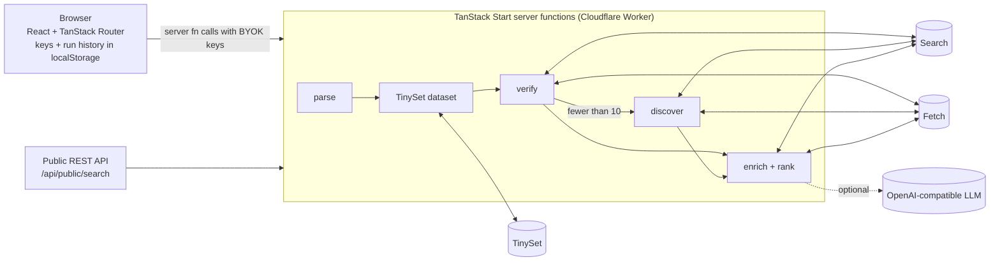
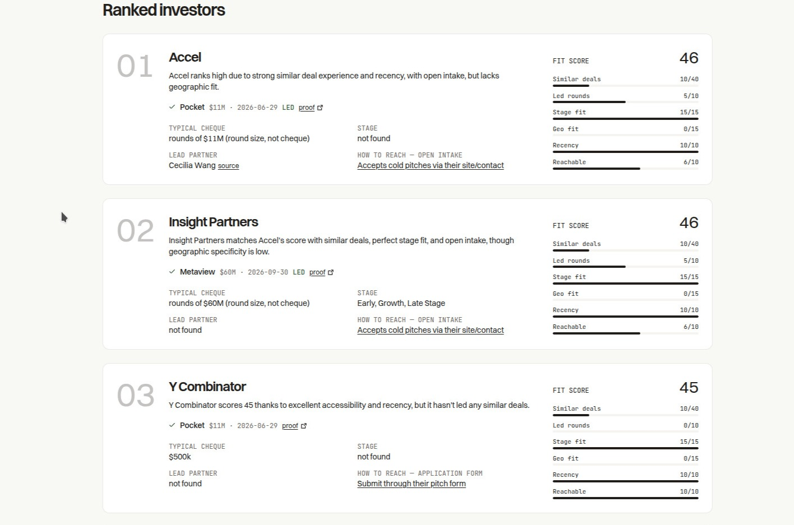
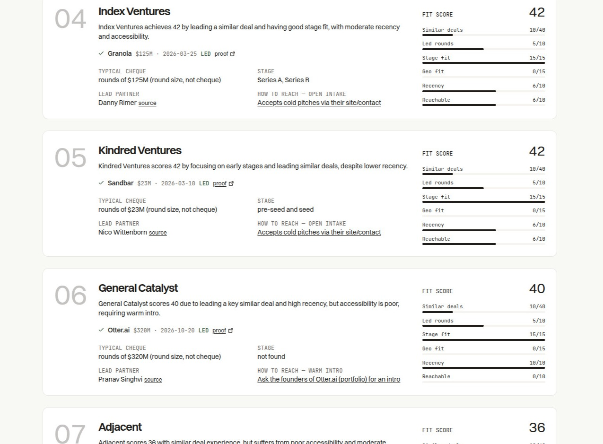

<div align="center">


<h1 align="center">TinyFund</h1>

<p align="center"><b>Who would actually fund you?</b></p>


</div>

---

## Project summary

Describe your startup in one line, for example *"AI bookkeeping for small businesses, seed, Brazil"*. TinyFund finds companies like yours that raised money in the last 18 months, checks every round against a live web page, and gives you a ranked list of the investors who backed them.

For each investor you get:

- the similar companies they backed, each with a proof link
- typical cheque size and stage
- the partner who led the deal (only when a page names them)
- how to reach them: application form, open intake, or a warm intro through a portfolio founder
- a score breakdown and a plain-language reason for its rank

**No made-up data.** An investor is listed only if a fetched page names them in a recent round. Anything that can't be found is shown as *not found*.

## How TinyFish is used

TinyFund runs on three TinyFish APIs. TinySet is the only paid one, and it's capped per search. Search and Fetch are free, and every step has a hard call budget that stops on the first rate-limit error instead of retrying.

| API | Endpoint | What TinyFund uses it for |
| --- | --- | --- |
| **TinySet** (Datasets) | `POST /v1/datasets` | Starts the main research: a 10-column spec asking for startups similar to yours that raised recently, with round, amount, date, investors (lead marked), lead partner and a proof link. Capped at 15 rows, so a search costs at most $1.50. |
| | `GET /v1/datasets/{id}` and `/rows` | Polled every 15 seconds to show progress and read the companies as they arrive. |
| | `POST /v1/datasets/{id}/runs/{run_id}/cancel` | Powers **Cancel run**, and stops a run still going after 20 minutes, so no more rows are billed. |
| **Fetch** | `POST api.fetch.tinyfish.ai` | Opens every proof link (10 URLs per call) to check the company, investors, lead partner and date are on the page. Also reads funding articles during discovery, and investor websites with `links: true` to find pitch forms and contact pages. |
| **Search** | `GET api.search.tinyfish.ai` | Finds an alternate news source when a proof link fails, finds more similar rounds when fewer than 10 verify (news filtered by date, localised to your country), and finds each investor's official website. |

## How it works

1. **Understand.** Your one-liner becomes a profile: sector, keywords, stage (or *any stage*), country and an 18-month cutoff. Rule-based by default, or refined by your own LLM if you add a key.
2. **Find.** TinySet researches funding news, investor portfolios, founder posts and grant portals for similar companies that raised since the cutoff.
3. **Verify.** Every proof link is fetched. A round counts only if the page names the company and at least one investor, and the date is inside the window. Leads and partners not named on the page are dropped.
4. **Rank.** The top investors' websites are read for cheque size, stages and pitch forms. Each investor gets a transparent score out of 100: similar deals (40), rounds led (10), stage fit (15), country fit (15), recency (10) and how reachable they are (10).

The run page shows each step live, and you can cancel at any time or rank early with what's been found.

## High-level architecture



- **Stateless.** A run id is the TinySet dataset id plus the encoded startup profile, so there is no database. History lives in your browser.
- **Bring your own keys.** Your TinyFish key (and optional AI key) is stored in your browser and sent with each request. A server-side `TINYFISH_API_KEY` works as a fallback.
- **Pure, tested core.** Scoring (`rank.ts`) and article extraction (`extract.ts`) are pure functions with unit tests, and the TinySet spec is tested against the API's limits.
- **Public API.** `POST /api/public/search` starts a run and `GET /api/public/search/{id}` returns JSON (or `?format=csv`). Full docs are at `/api-docs`.

```text
src/
├─ routes/                 pages + /api/public/* server routes
├─ components/             app shell, run progress, UI primitives
└─ lib/tinyfund/
   ├─ pipeline.server.ts   TinySet, Fetch, Search calls + budgets
   ├─ extract.ts           rule-based funding-article parser
   ├─ rank.ts              scoring + explanations
   └─ store.ts             keys + run history in localStorage
```

## Project setup

**Requirements:** Node.js 22+ and npm.

```sh
git clone https://github.com/GxAditya/Tinyfund.git
cd Tinyfund
npm install
npm run dev          # http://localhost:8080
```

Open **Keys** in the header and paste your [TinyFish](https://tinyfish.ai) API key (a personal key; TinySet refuses organization keys). An AI key is optional; presets cover OpenAI, Claude, Grok, Groq, Gemini and OpenRouter's free models.

| Script | What it does |
| --- | --- |
| `npm run dev` | Dev server with hot reload |
| `npm run build` | Production build into `.output/` |
| `npm test` | Unit tests |
| `npm run lint` | ESLint + Prettier |

**Deploy.** The build targets Cloudflare Workers (free tier) by default:

```sh
npm run build && npx nitro deploy --prebuilt
```

Set a [Nitro preset](https://nitro.build/deploy) such as `NITRO_PRESET=node-server`, `vercel` or `netlify` to deploy elsewhere.

## Demo

Ranked investors for a sample search, each with its proof-linked deal, cheque size, stage, lead partner, how to reach them and the score breakdown.

<p align="center">
  
</p>

<p align="center">
  
</p>
